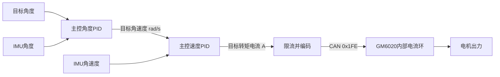

# GM6020 电流模式与云台调试

本次对象：FreeRTOS OMNI_jpl 的 Yaw、Pitch 两个 GM6020。用户已在 RoboMaster Assistant 打开电流环。验收：发送正确电流帧，橙灯模式警告消失，两轴能归中/保持姿态，disable 后发送零电流。编译和主机测试已验证协议路径；实车稳定性待测试。

## 六种控制方式

| 名称 | 你给的目标 | 通俗理解 |
|---|---|---|
| 电压控制 | 驱动电压/电压码 | 给多少电压；电流还受转速、负载、电阻等影响 |
| 电流控制 | 转矩电流 Iq | 给多大的出力；并不保证固定转速或位置 |
| 力矩控制 | 扭矩 N·m | 近似用 τ=Kt×Iq 换成电流，实际还有摩擦、负载等影响 |
| 速度控制 | rad/s 或 rpm | 快了减力、慢了加力；零速度也可能需要非零电流保持 |
| 位置控制 | 角度 | 没到目标就转，到目标后抵抗外部扰动 |
| MIT 控制 | 位置、速度、Kp、Kd、前馈力矩 | 常见关节驱动协议，像弹簧和阻尼一起拉住目标 |

这些不是互斥的六种算法。当前云台是“位置控制”，其速度环输出“电流目标”，电调内部再控制电流。

电流环在电调里，主控无需重新实现FOC。零电流是放松出力，不是主动锁住位置；保持位置时可能需要电流抵消枪口重力。电流限幅也不是持续堵转允许值，需要考虑手册的温度和工作范围。

MIT常见形式：τ=Kp×(目标位置−实际位置)+Kd×(目标速度−实际速度)+前馈力矩。Kp像弹簧刚度，Kd像阻尼。它不是当前串级双环的同名PID，也不是GM6020的CAN协议；不要把MIT指令发给6020。

## 核对到的协议差异

依据用户的6020.pdf，第6至8页（PDF页号），以及官方v1.4手册：

| 项目 | 电压模式 | 电流模式 |
|---|---|---|
| ID1..4发送帧 | 0x1FF | 0x1FE |
| ID5..7发送帧 | 0x2FF | 0x2FE |
| 电流指令范围 | 不适用 | ±16384对应±3A |
| 反馈ID | 0x204+电机ID | 相同 |

每个电机占两个字节，高字节在前，负数按16位补码。当前Yaw=CAN1/电机3，写0x1FE的byte4/5；Pitch=CAN2/电机4，写0x1FE的byte6/7。反馈仍为0x207/0x208。

橙灯常亮表示电流模式收到电压指令。原固件发送0x1FF，即使发送零值，也属于电压帧。本次电机注册选择DJI_GM6020_CURRENT，自动分到电流帧；保留旧DJI_GM6020表示电压设备，方便其他对象使用。控制任务只用电机句柄，不手工拼帧。摩擦轮和拨弹继续用它们自己的0x200电流帧。

## 改参数的位置与单位

Task/gimbal/gimbal_config.h：

- `*_KP/KI/KD_V_IMU`：手动/归中速度环，现在输出A；Kp单位A/(rad/s)，Ki乘时间积分，Kd乘误差/测量变化率。
- `*_KP/KI/KD_V_AUTO`：自瞄速度环，也输出A。
- `*_INTEGRAL_V_*`：积分输出上限，A。
- `*_MAX_V_*`：总输出上限，A。
- `GIMBAL_CURRENT_LIMIT_A`：最终两轴电流上限，当前1.5A；电机层同时限幅到8192。
- `*_A_*`：角度环仍然是度输入、rad/s输出，参数本次不变。
- `CENTER_ECD_*`：机械归中编码器值，不是PID参数。

电流码=目标A×16384/3。例如0.75A=4096，1.5A=8192。此换算只用于发送指令；手册没有在该反馈表中明确反馈current_raw的安培缩放，暂不按相同系数解释反馈。

原速度环5000、4500等数字的输出是电压码，不能直接当作电流增益。本次采用未实车验证的起步参数：Yaw Kp=0.4、Ki=Kd=0；Pitch Kp=0.4、Ki=0.2、Kd=0，积分上限0.3A。手动和AUTO使用相同的电流速度环起点。它们不是旧电压参数的等效转换，也不是保证最优的参数。

先检查电流帧和方向、归中值。然后优先调速度环：D先保持0，P小步调整；Pitch需要抗重力时再调I，并观察积分上限。速度环稳后再调角度环P。一次改一项，重新编译烧录。若归中2秒超时，faults会出现64；不要只盲目放大电流，需要核对方向、限位、零点和实际负载。

## 变量与操作

Open-LinkScope.cmd 新增第16组 `gimbal_current`。只预选三条曲线，其他变量看数字：

- `debug_cmd.online/enabled`：均为1才能运行。
- `debug_gimbal.faults`：无阻断时为0。
- `debug_motor[4].tx_id`、`debug_motor[5].tx_id`：都应为510，即0x1FE。
- `debug_gimbal.yaw_output/pitch_output`：电流指令码；本次绝对值不超过8192。
- `debug_motor[4/5].queued_output_raw`：实际装入CAN邮箱的电流码，不证明电调已经执行。
- `debug_motor[4/5].current_raw`：电机反馈的转矩电流原始值。

板上测试：打开遥控器，SW2中位，摇杆回中；两轴应归中进入mode=2。轻推Yaw/Pitch应跟随，松开应保持目标；SW2关闭位应发零电流。橙灯不应再持续提示电压指令。若云台不能归中，shoot仍会被gimbal_ready挡住，需先完成云台验收。

不要在烧录后继续用旧ELF读变量：本次debug_motor新增tx_id字段，结构布局改变。烧录与调试都使用build-arm-debug/OMNI_jpl.elf。

## 验证及参考

主机回归覆盖：两条CAN、ID1..4/5..7分组、混用C620/6020电压/电流、电流限幅、停机与指令超时、双环编码与方向。ARM编译通过，不代表实车PID已经调好。

- [DJI GM6020 v1.4官方手册](https://rm-static.djicdn.com/tem/17348/RoboMaster%20GM6020%E7%9B%B4%E6%B5%81%E6%97%A0%E5%88%B7%E7%94%B5%E6%9C%BA%E4%BD%BF%E7%94%A8%E8%AF%B4%E6%98%8E20231013.pdf)
- [CubeMars MIT控制参考](https://www.cubemars.com/images/file/20250401/1743497608964879.pdf)
