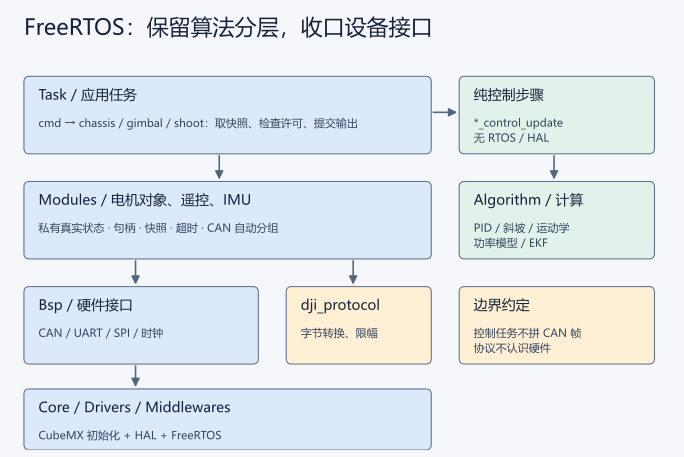
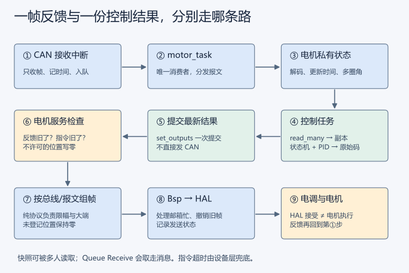

# FreeRTOS 机器人框架：算法独立，设备好用

更新：2026-09-26。上车先看 [遥控器、云台与通信联调](bringup_guide.md)，包含最新操作图与全链路图。

## 一张图看懂



Task 像班长：取指令、取快照、检查能否运行、调用计算、提交结果。
Algorithm 像计算器：只接受数字和参数，不知道谁在调用，也不启动电机。
Modules 像设备管理员：保存真实状态、检查掉线、把不同任务的结果拼成完整报文。
Bsp 像接线员：认识 HAL 和硬件，负责收发。Core 保留 CubeMX 的初始化。

实际依赖是 `Task → dji_motor → bsp_can`，并且 `dji_motor → dji_protocol`。
**dji_protocol 不依赖 bsp_can**；它只解码、编码和限幅，不保存电机状态。

## 目录与阅读顺序

```
Algorithm/
  pid/                  PID 对象、明确 dt
  ramp/                 斜坡
  omni_kinematics/       全向轮正逆解
  power_model/          底盘功率估算
  QuaternionEKF/        旧版 EKF、姿态初始化与零偏
  kalman_filter/        固定容量矩阵状态
Bsp/
  can/ uart/ imu/ time/  各自的 .c 和 .h
  nuc/ referee/         USB CDC、裁判串口
Modules/
  motor/                句柄 API、服务入口、纯协议
  remote/               DBUS 解码与遥控快照
  imu/                  BMI088 器件驱动
  transmission/         旧 NUC 协议、目标快照
  referee/ referee_ui/   裁判协议快照、客户端图形编码
Task/
  robot.c               唯一整车接线配置、注册、创建任务
  cmd/                  遥控到标准命令
  chassis/              chassis_task + chassis_control + config
  gimbal/               gimbal_task + gimbal_control + config
  shoot/                shoot_task + shoot_control + config
  ins/ motor/           姿态生产者、电机设备服务
  transmission/ referee/ referee_ui/   外部通信与显示
```

先看 `Task/robot.c`，再看三个 `*_task.c`，最后看各自的 `*_control.c`。
整车控制计算在 Task 下独立文件中，因为它包含本车参数与状态机；通用算法留在 Algorithm。
control 文件不包含 FreeRTOS/HAL，电脑测试直接调用它们。
CMake 自动收集四个目录的源文件；Algorithm/Bsp 的子目录加入头文件搜索路径。
新增同名头文件前应避免歧义。手动移目录后重新加载 CMake。

## 电机：名字、句柄、快照

`DjiMotorId` 表示用途；`esc_id` 才是电调编号。两者不能混为一谈。

| 语义名字 | 总线 / 类型 / 电调号 | 反馈 ID | 输出组 |
| --- | --- | --- | --- |
| CHASSIS_FL / FR / RL / RR | CAN1 / M3508 / 1～4 | 0x201～0x204 | 0x200 |
| GIMBAL_YAW | CAN1 / GM6020 / 3 | 0x207 | 0x1ff |
| GIMBAL_PITCH | CAN2 / GM6020 / 4 | 0x208 | 0x1ff |
| FRICTION_L / R | CAN2 / M3508 / 1、2 | 0x201、0x202 | 0x200 |
| TRIGGER | CAN2 / M2006 / 3 | 0x203 | 0x200 |

四轮名字暂按原数组顺序命名，数值与控制顺序保持不变；旧代码没有可靠物理轮位注释，仍需确认 FL/FR/RL/RR 与实物一致。

注册自动完成：占用静态对象、检查语义 ID、推导收发 ID 和分组、检查反馈 ID/发送位置冲突、保存两个超时值。
总线仅支持本板 CAN1/CAN2；不搬入 RTT 的通用设备注册框架，也不为每个电机分配堆内存或软件定时器。
注册必须在任务创建前完成，不能运行中重注册。
句柄隐藏结构体内容，没有 `motor->measure` 这样的外部写入口。
失败返回 NULL，已注册对象保持原样。

```c
DjiMotorHandle yaw = dji_motor_find(MOTOR_GIMBAL_YAW);
DjiMotorFeedback sample;
if (dji_motor_read(yaw, &sample) && sample.online && sample.transport_ready) {
    /* sample 是副本，角速度反馈单位为转子 RPM。 */
}
dji_motor_relax(yaw); /* 提交零输出；统一发送者下一周期处理。 */
```

`read_many` 在一个短临界区复制多个对象，但这不等于电机在物理上同时采样；
每个快照保留自己的接收时间。读取不会消费 CAN 队列。
`set_outputs` 在一个短临界区提交多个控制结果，避免四轮更新到一半被发送者读走。
返回 true 仅代表内存提交成功。是否收到电机反馈、HAL 是否接收报文，是另外的状态。

每个电机只有一个控制任务写指令；motor_task 是唯一接收/发送者。
同一 CAN 帧的多个位置可以来自不同控制任务，电机层统一拼帧，未配置位置写零。
GM6020 输出是电压码，3508/2006 是电流码，所以公开接口叫 output。
协议编码函数沿用历史名字 encode_currents，其实际操作对这两类码值都只是限幅与大端打包。
限值：M3508 ≤16384，M2006 ≤10000，GM6020 ≤30000。配置为 0 的对象只读。

多圈角保存在电机模块。第一帧作为零点，跨 8191/0 按最短差累计。
前提是相邻反馈转角小于半圈；掉线后的真实圈数无法猜测。
反馈超过超时再恢复时，累计角重新起算、generation 增加，拨弹控制器重置位置目标。

## Queue 和旧发布订阅，各自解决什么问题

旧 `drv_msg` 是“一个话题一份最新值”，信号量保护复制。读取不取走数据，也没有消息序号；
读取成功不能说明出现新消息。现有实现还缺少话题数量、名称长度、同名类型长度的完整检查，
部分分配在 NULL 检查前就使用了地址。保留它的使用体验，不直接照搬实现。

| 场景 | 当前实现 | 原因 |
| --- | --- | --- |
| CAN/UART ISR 到唯一解析任务 | 有限长度 Queue | 保存顺序、复制数据、FromISR 接口、队满可计数 |
| cmd 到一个控制任务 | 长度 1 Queue + Overwrite | 只要最新目标，不积压过去的操纵 |
| 电机、遥控、姿态供多个任务读 | 模块快照 API | 多读者不会把别人的数据取走 |
| 必须逐条执行的事件 | 应使用专用事件 Queue | 不能用最新值邮箱保证每个事件都送达 |

FreeRTOS Queue 提供复制、阻塞等待/唤醒、ISR 版本和线程同步，省去自己实现这些机制。
代价是内存、拷贝和内核调度开销；并非任何场景都比简短快照更快。
**多任务 Receive 同一个 Queue 是竞争消费，不是广播。**
Peek 不移除消息；长度 1 + Overwrite/Peek 可做最新值话题，但仍需时间戳/序号，
不能因此声称每个订阅者都收到每次发布。
目前不添加第二套通用消息框架；有一对多事件需求时再明确扇出和丢包策略。
依据：[FreeRTOS 队列说明](https://github.com/FreeRTOS/FreeRTOS-Kernel-Book/blob/main/ch05.md)、
[xQueuePeek](https://freertos.org/Documentation/02-Kernel/04-API-references/06-Queues/13-xQueuePeek)。

## 一条数据如何经过系统



CAN IRQ 只取帧、记时间、入队，不运行 PID。Queue 满时记录 queue_drops。
motor_task 每次最多处理 32 帧，防止一直收报文而饿死后续工作，然后检查超时、发送各组输出。
接收时间是原始帧时间，不能用“读快照的现在”冒充新数据。
`volatile` 仅用于调试可见性，不保证结构体完整；控制路径靠短临界区复制。
临界区不等待 HAL、不打印、不延时。
HAL 的邮箱只有有限几个，最新发送会尝试撤销尚未发出的旧帧；遇到忙返回失败，保留统计。
HAL 接受发送不等于电调执行；已有总线帧不能撤回。
发送失败会使下一次服务清掉旧指令并尝试零输出，控制任务读取 transport_ready 后复位状态。
该状态是当前快照，不是持久化的历史故障日志。

反馈/指令超时均由电机配置决定（整车当前为 20 ms）。
即使控制任务停止刷新，设备任务仍把过期输出置零。
如果整个 MCU 或设备任务卡死，软件本身不能继续发送零；电调超时策略与整机看门狗需实测。
任务层另检查遥控新鲜度（100 ms）、dt（0～20 ms）和模块就绪状态。

## 云台、摩擦轮与拨弹

云台：RELAX → 等待操纵归零 → INIT → GYRO；已有接口支持外部绝对角 AUTO 指令。
INIT 从当前编码器角平滑回零，2 秒未到位锁定 FAULT；关闭总开关后才重新尝试。
归中后接住当前惯性角度，模式切换重置 PID，避免把编码器零点当作 IMU 零点。
角度环输入度、输出 rad/s，速度环输出 GM6020 电压码。Yaw 输出符号沿用旧版为负。
Pitch 目标及编码器机械范围均限制在 -20°～30°；中心值沿用 5800/3532。
CAN 或 IMU 过期立即提交零，重新就绪后重新归中。
底盘保持本车坐标控制；NUC、裁判通信与 UI 已接入，尚未增加云台跟随或弹仓盖舵机。
AUTO 由鼠标右键和新鲜 NUC 目标共同许可；三连发仍为算法接口，拨轮负向已映射手动反转。

摩擦轮左右目标沿用 +6200/-6200 RPM，加入按真实 dt 的加速斜坡。
两轮均到速并稳定 100 ms 才允许拨弹；未到速时的单发按下不会缓存成“稍后突然发射”。
单发按上升沿增加 45×36 度转子角；三连发增加三倍；连发只用速度环。
持续 60 ms 大电流且低速判堵转，反转 120 ms 后等待松开扳机，不无限反复重试。
失联、总开关关闭、摩擦轮关闭、云台未就绪、dt 异常都清 PID 和输出。
断线恢复后必须先松扳机。单发模式切换继承当前角度，防止追逐旧目标。
射击命令使用最新值邮箱；短于输入采样周期的按键脉冲不保证被采集。

## IMU 与 EKF

ACC 片选使用 `BMI088_ACC_CS_Pin/Port`（PA4），GYRO 使用对应 GYRO 宏（PB0）。
沿用 CubeMX 生成的 GPIO 初始高电平。读 ACC 有额外 dummy byte，GYRO 没有；
失败也释放片选。SPI1 当前由 ins_task 独占，若以后共享设备，要统一总线互斥。
BMI088 驱动提供 m/s²、rad/s；不在那里混入云台安装方向。

沿用 RTT 的 QuaternionEKF 与 Kalman 实现，保留作者标注。
矩阵缓冲改为对象内固定容量，去掉运行期 malloc；每维最多 6，当前为 6/0/3。
整个 EKF 仍是单实例，只由 ins_task 调用。
开机需连续 500 个低角速度、接近重力的样本，约 1 秒，估计三轴零偏；
这只是静止条件检查，不是严格的静止证明，缓慢匀速转动仍可能污染校准。
初始重力方向算出四元数，避免倾斜开机先假定水平。
数值异常、采样超期或 SPI 失败后，姿态无效并重新校准，generation 防止控制器继续用旧参考系。
发布方向沿用旧代码：yaw=-YawTotalAngle，pitch=Roll，速度为 -gyroZ、gyroY。
注意旧 EKF 的字段命名：Roll 的公式对应绕 Y 轴角，因此与 gyroY 配对。
本次没有移植温控 PWM；长时间零漂、温升及安装方向必须实测。无磁力计时 yaw 仍会漂移。

## 调度、内存和调试

cmd 10 ms；chassis、motor、shoot、ins 2 ms；gimbal 1 ms。FreeRTOS tick 为 1 kHz。
控制任务优先级 4；cmd、motor、ins 为 3；referee、transmission 为 2，referee_ui 为 1。任务优先级与硬件中断优先级是两套规则。
新增任务后堆由 15360 调到 32768 字节，已同步 FreeRTOSConfig.h 和 .ioc。
这是 FreeRTOS 的堆，不是链接脚本的 C 库 heap。任务栈参数单位为 StackType_t 字，而非字节。
启动先创建控制命令队列、电机对象和裁判发送队列，才创建任务；失败交给已有 Error_Handler。USB 和裁判接收任务自行初始化接收资源并重试，不阻塞控制任务。
任务栈高水位、最坏周期与总线负载仍应上板测量，链接成功不代表运行时余量经过验证。

LinkScope：debug_motor[语义ID]、debug_motor_can、debug_chassis_tx、debug_shoot；
云台的 state/controller、INS 的 state/bmi088/estimator 也保留实际对象可观察。
这些调试数据不作为跨任务通信接口。

## 下一步上板确认

1. 架空底盘、空载检查，先保持总开关关闭：所有控制码应为 0。
2. 静止约 1 秒后确认姿态有效；手动转动云台，检查角度和速度同向、编码器方向与旧版一致。
3. 总开关中位、操纵归零后云台归中；无法到位应锁定超时，关闭总开关后才能再试。
4. 摩擦轮单独到速，观察左右旋向；确认拨弹等待到速，单发长按仅执行一次。
5. 断遥控、断某电机反馈、暂停控制任务，检查零输出与恢复条件；同时看发送错误和 Queue 丢帧。
6. 核实实际轮位、归中值、机械限位与 PID，记录堆余量和任务耗时后再整车联调。

协议参考：[C620 手册](https://cdn-hz.robomaster.com/robomasters/public/document/RoboMaster%20C620%20Brushless%20DC%20Motor%20Speed%20Controller%20V1.0.pdf)、
[GM6020 手册](https://rm-static.djicdn.com/tem/17348/RoboMaster%20GM6020%E7%9B%B4%E6%B5%81%E6%97%A0%E5%88%B7%E7%94%B5%E6%9C%BA%E4%BD%BF%E7%94%A8%E8%AF%B4%E6%98%8E.pdf)。
