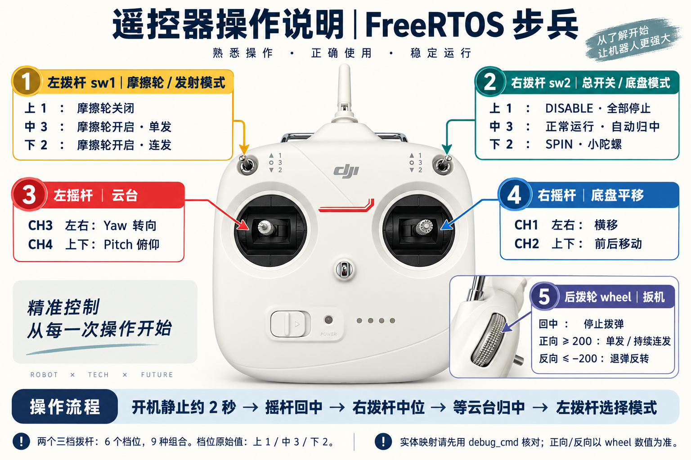

# 遥控器、云台和通信：上车联调指南

本次工程位于 `E:/LEARN_CODE/OMNI_INFANTRY/OMNI_freeRTOS/OMNI_jpl`。先看操作图，再用 LinkScope 总览确认是哪一层没有准备好。

## 两个拨杆怎么分配

两个三挡拨杆共有 **6 个挡位、9 种组合**。拨杆外壳原来印的 GPS / ATTI 等文字是航模用途；本车按固件重新分配。线上数值从上到下是 **1、3、2**，不是 1、2、3。

| 控件 | 上 / 中 / 下 | 本车动作 |
|---|---|---|
| 左拨杆 `sw1` | 1 / 3 / 2 | 摩擦轮关闭 / 摩擦轮开启、单发 / 摩擦轮开启、连发 |
| 右拨杆 `sw2` | 1 / 3 / 2 | DISABLE / 正常运行并自动归中 / SPIN 小陀螺 |
| 右摇杆 CH1 / CH2 | 左右 / 上下 | 底盘横移 / 前后移 |
| 左摇杆 CH3 / CH4 | 左右 / 上下 | 云台 Yaw / Pitch |
| 背面拨轮 `wheel` | 回中 / ≥200 / ≤−200 | 不请求拨弹 / 单发或连发 / 反向退弹 |

**工程 `sw1` 是 DBUS 协议 S2，工程 `sw2` 是协议 S1。** 旧工程注释把它们对应为左、右；首次使用时在 disable 状态一次只拨一个开关，用 `debug_cmd.sw1/sw2` 核对实物。拨轮的物理推拉方向也用数值核对，图没有猜正负方向。

正常档不再把 CH3 同时用于转底盘和转云台。底盘使用本车坐标系，尚未增加云台跟随；SPIN 使用固定 4.5 rad/s 目标，仍经过原斜坡和功率限制。

“自动归中”是进入允许运行状态后的一个过程，不需要长期占一个拨杆位置：先静止约 2 秒完成 INS 标定，两个摇杆回中，再把右拨杆置中，云台先归中再接收角速度指令。归中超时会锁定；检查中心值和方向后，用右拨杆上→中重新开始。仅 IMU 重启不会清掉已锁定的归中故障。

摩擦轮需云台归中、三个发射电机在线、指令新鲜。拨轮或鼠标一直按住时恢复不会自动补射，需要先释放；摩擦轮到速后再次触发单发。拨轮回中取消扳机请求，已经开始的单发会完成既定的一格位置运动。右拨杆上位会清除所有输出请求。

键鼠补充：鼠标移动控制云台，左键是扳机；右键按住且 NUC 角度新鲜才进入 AUTO。F 恢复、G 禁止摩擦轮，G 优先；**左拨杆上位始终关闭摩擦轮**，F 不越过它。切换左拨杆会清除键盘模式锁存；V 上升沿可在中位切换单发/连发，下位固定连发。R 重新绘制裁判客户端 UI。NUC 的开火建议只记录，不代替操作者触发。

## 为什么底盘能动，上装完全不动

找到一条能解释现象的确定软件错误：向 BMI088 陀螺仪带宽寄存器 `0x10` 写 `0x01` 后，旧代码要求读回也等于 `0x01`。但是该寄存器 bit7 恒为 1，正常读回是 `0x81`。原比较把正常硬件当成初始化失败。

现在只比较可配置的低 3 位：`(actual & 0x07) == (expected & 0x07)`；没有绕开芯片 ID、SPI 失败检查、姿态有效性或电机在线保护。主机测试的假芯片也会返回真实的只读位，避免只测试“写什么读什么”。依据：[Bosch BMI088 数据手册 §5.5.6](https://www.bosch-sensortec.com/media/boschsensortec/downloads/datasheets/bst-bmi088-ds001.pdf)。

这解释了为什么只改 cmd 不一定能解决。本次同时把 cmd 映射收口，并显示各层许可的原因。实车还有没有第二个问题，需要烧录后观察，编译通过不能证明接线、电机方向或中心值正确。

## 最短排查路线

双击 [LinkScope 快捷入口](LinkScope/Open-LinkScope.cmd)，选 1「总览」。[完整变量表](LinkScope/README.md) 解释了每个变量、单位和故障位。

1. `debug_cmd.enabled=1`：遥控和总开关允许动作；`neutral=1`：四个通道和鼠标都已回中。
2. `debug_bmi088.init_failures` 不再持续增长；两个 ID 应为 30、15。`debug_ins.stationary_samples` 累积约 500 后，`valid=1`。
3. `debug_gimbal.yaw_online/pitch_online=1`、`tx_ready=1`。Yaw 是 CAN1 / 0x207；Pitch 是 CAN2 / 0x208。
4. 云台 `mode` 从 0→1→2，`faults=0`。若始终是 0，看故障位；若到 4，是归中超时，不能靠强制修改 valid 来处理。
5. 左拨杆置中后，`debug_cmd.friction=1`、`debug_shoot_task.gimbal_ready=1`，然后观察摩擦轮输出及到速标志。

调试变量只是观察窗口。模块通信使用受保护的快照和命令队列，不读取 LinkScope 的显示副本。

## 新通信链路如何接入

```mermaid
flowchart TB
    UART3[USART3 / DBUS] --> R[remote 模块]
    R --> CMD[cmd_map_update 纯指令映射]
    USB[USB FS CDC / NUC] --> V[transmission 字节协议与目标快照]
    V --> CMD
    UART6[USART6 / 裁判] --> REF[referee 校验、拆包和状态快照]
    REF --> V
    REF --> UI[客户端 UI]
    CMD --> UI
    UI --> TX[裁判发送队列]
    TX --> UART6
    CMD --> C[底盘 control]
    CMD --> G[云台 control]
    CMD --> S[摩擦轮与拨弹 control]
    IMU[BMI088 → INS / EKF] --> G
    G --> S
    C --> M[dji_motor 句柄、状态与统一分组]
    G --> M
    S --> M
    M --> CAN[bsp_can → HAL CAN]
```

- [NUC 移植说明](transmission_port.md)：仍使用板载 USB 虚拟串口，PA11/PA12；保留旧 BCP 包、校验和角度符号。USB 时钟必须是 48 MHz；本工程 PLLQ=7，CPU 仍为 168 MHz。USB 硬件句柄、引脚与 OTG_FS IRQ 由 CubeMX 管理；Bsp/nuc 接 CDC 协议栈，不再定义第二份句柄/MSP/IRQ。不要另外生成 USB_DEVICE 中间件。
- [裁判移植说明](referee_port.md)：USART6，PG14 TX / PG9 RX，115200、8N1，RX 循环 DMA + IDLE。中断只复制字节，任务做 CRC 和拆包；错误、溢出、重启换代后丢弃旧半帧。TX 使用独立持久缓冲区，发送完成前不复用。
- [客户端 UI](referee_ui.md)：保留原 9 个元素和布局，新增/修改通过统一交互发送接口，发送者与客户端 ID 来自裁判快照，不写死蓝方 3 号。
- 裁判布局以旧工程实际字段为移植依据；不把旧文件中已经写成 reserved 的字节当实测功率。当前只把裁判快照接入 NUC 队色和 UI；底盘仍使用既有功率模型预算，热量字段已可读，但没有凭旧布局宣称完成当前赛季功率/热量策略。

## Queue 与发布订阅怎么选

Queue 像“收件箱”：收一个就取走一个，适合 UART/CAN 字节流和需要逐条处理的命令。FreeRTOS 已提供 ISR 安全收发、阻塞唤醒、固定容量、按值复制。**多个任务读同一个 Queue 会抢消息，不是广播。**

状态像“公告栏”：电机、遥控、INS、NUC、裁判模块各有唯一写入者，`get_state` 给每个读者一份副本，再检查数据年龄。这保留原发布订阅容易使用的特点，也避免把底层队列和硬件句柄暴露到控制任务。

连续控制目标采用长度 1 的 Queue + overwrite，只保留最新命令。UI 交互发送采用 FIFO，不能覆盖成最后一条。所有数据保留真实接收时间，不能把任务取出的时刻伪装成新数据。

协议层只懂字节，设备层拥有真实状态，task 负责连接，control 负责计算；新的功能仍按这个方向继续开发。详细 API 见 [接口速查](task_interfaces.md)，验证结果见 [迁移记录](migration_status.md)。
