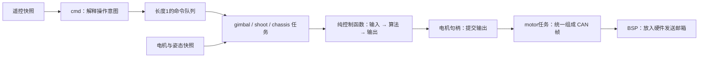

# 从一个动作开始读代码

先看懂“拨一下摇杆，电机为什么动”。不用从 USB 中断、DMA、FreeRTOS 调度器开始通读。NUC 任务目前确实混有收包和连接恢复细节，这部分还可以继续收口；读起来费劲不全是知识不够。

## 第一遍只读四处

| 顺序 | 文件 | 这一遍只回答一个问题 |
|---|---|---|
| 1 | `Task/robot.c` | 车上有哪些电机？名字对应哪条 CAN、哪个电调编号？ |
| 2 | `Task/cmd/cmd_mapping.c` | 拨杆、摇杆怎样变成“使能、速度、开摩擦轮”等命令？ |
| 3 | `Task/gimbal/gimbal_task.c` | 云台任务从哪里拿命令和测量值，什么时候允许输出？ |
| 4 | `Task/gimbal/gimbal_control.c` | 给定目标和测量值，双环 PID 怎样算出电机输出？ |

读到不认识的底层函数，先看它的头文件注释：输入是什么、返回什么、失败意味着什么。先不跳进去逐行追寄存器。

控制任务负责“拿齐材料再算”，纯控制函数负责“怎么算”，电机模块负责“这台电机的真实状态”。任务读到的是状态副本，改副本不会改电机本体。`debug_*` 是旁边的观察窗口，不是发命令的入口。

长度为 1 的队列像一块留言板：新命令覆盖旧命令，控制任务不用慢慢执行过期摇杆操作。队列不会自动广播；多个任务各有命令队列。电机状态则用快照支持多个读者，避免一个读者把另一个读者的数据取走。

## 改一个行为，到哪里去

| 想做的事 | 入口 |
|---|---|
| 改左拨杆/右拨杆的功能 | `Task/cmd/cmd_mapping.c` |
| 改 Pitch 活动范围 | `Task/gimbal/gimbal_config.h` 的 `PIT_ANGLE_MIN/MAX` |
| 改云台手动双环 PID | 同文件 `*_A_IMU` 角度环、`*_V_IMU` 速度环；实际启用字段以 `gimbal_control.c` 的 `configure()` 为准 |
| 改摇杆推动时目标变化速度 | `cmd_mapping.c` 的 `yaw_rate_deg_s/pitch_rate_deg_s`；另受 `GIMBAL_MAX_RATE_DEG_S` 限制 |
| 改电调编号/接线声明 | `Task/robot.c` 的 `motor_config` |
| 改摩擦目标转速/拨弹步进量 | `Task/shoot/shoot_config.h` |
| 使用 NUC 识别结果 | `Modules/transmission/transmission.h` 的 `transmission_get_state()` |
| 修改 NUC 字节协议 | `Modules/transmission/transmission_protocol.c` |
| 查 USB 枚举、丢包、插拔恢复 | 最后再看 `Bsp/nuc/` |

注意：配置文件里保留的旧 `GIMBAL_RC_MOVE_RATIO_PIT/YAW` 当前没有被映射函数使用，改它们不会改变遥控手感；不要只凭宏名字判断是否生效。云台配置中旧 `CHASSIS_*_FOLLOW` 仍未使用；新的有效跟随参数在底盘配置的 `CHASSIS_FOLLOW_*`。

## Pitch “慢”和“范围小”是两件事

当前摇杆控制**目标转动速度**，不是“摇杆打半程就转到半个角度”。目标每圈更新：`新目标角度 = 原目标角度 + 摇杆给出的角速度 × 时间`。回中后停止修改目标，云台继续保持该角度。

1. 先看目标角度是否随操作变化。如果目标本身变化慢，查命令倍率、死区和限幅。
2. 目标变化快，实际角度跟得慢，才继续查 PID、输出饱和、反馈、负载和 CAN 是否持续发送。
3. 到某角度就不再变，查限位。当前默认范围为 −20°～+30°；目标有软件限幅，编码器相对机械中心也有输出方向限制。增大限位不会直接提高响应速度。

角度环输入单位是度，输出给速度环的是 rad/s；速度环测量是陀螺仪 rad/s，最后输出 GM6020 原始电压码。不能把电机 rpm 直接塞进这个速度环。PID 先看内环、再看外环；每次只改一项并记录现象。扩大限位前先确认机构的真实余量。

2026-09-27 已加入右拨杆中位跟随、下位小陀螺。跟随算法在 `Algorithm/chassis_follow/`，底盘任务读取新鲜的云台快照后调用；Pitch 限位和PID未改。跟随使用 Yaw 相对底盘角度产生底盘 `wz`，不能直接拿 INS 的全局 Yaw 当两机构夹角。

## NUC 的三层，不必一次全学会

| 层 | 像什么 | 本工程位置 |
|---|---|---|
| 业务使用 | 看懂收到的内容，决定是否自瞄 | `cmd_mapping.c` 读取视觉快照，要求 `aim_valid` |
| 协议与状态 | 把字节翻译成 yaw/pitch，判断是否过期 | `Modules/transmission/` |
| 搬运 | USB 收了多少字节、电脑是否拔掉 | `Bsp/nuc/` |

先看 `TransmissionState`，再看 `cmd_mapping.c` 的 `auto_aim` 分支。角度包 100 ms 过期，心跳不能延长旧角度的寿命；进入 AUTO 时记住基准角，只在这份基准上叠加偏移，不每周期累加同一包。

`transmission_task.c` 目前还负责连接代次、队列搬运和归中参考切换。归中/INS 重启后丢弃旧参考下的目标，是为了避免把旧坐标下的指令用到新坐标下。先理解这个目的，暂时跳过 USB 缓冲区的实现。下一步整理 NUC 接口时，应将纯搬运收进模块服务，任务保留“读姿态—更新参考—发送状态”这几个业务动作。

## 当前发射故障怎么读

用户截图：`faults=34 → 2 → 66`，`motors_ready=0`，三个输出均为 0。

- 34 = 32（没有开摩擦轮）+ 2（至少一个发射电机反馈不新鲜）。
- 2 = 已请求开摩擦轮，但电机反馈仍不齐。
- 66 = 2 + 64（未解锁时仍有发射请求）。64 不说明机械堵转。

用户随后确认左摩擦的 C620 红灯快闪。官方手册第 29–31 页区分：连续红灯快闪是电机位置传感器参数校准失败；每秒闪 3 次再停顿是 7-Pin 位置传感器数据丢失。先断电检查 7-Pin 和三相线；确认校准失败后，按手册在无弹、空载且电机可自由转动时重新校准，校准会自动转动。灯码不是“CAN 一定坏了”的证明。[C620 官方手册](https://rm-static.djicdn.com/tem/17348/RoboMaster%20C620%20Brushless%20DC%20Motor%20Speed%20Controller%20V1.01.pdf)

先用 LinkScope 第 6 组看 `debug_motor[6/7/8].online`：6=拨弹、7=左摩擦、8=右摩擦。当前接线声明都在 CAN2；2026-09-27 按实车确认后，拨弹、左摩擦、右摩擦编号分别为 3、2、1。三者只要有一台反馈离线，发射任务就一起保持零输出。先恢复在线，再判断 `friction_ready`；不要删除离线检查来“试着转”。

两个摩擦轮实际转速分别接近左 −6200、右 +6200 rpm（各误差小于 400）并保持 100 ms 后，才允许拨弹。提前扣住的单发不会被保存，准备好后松回中再重新拨动。方向和转速必须由实车确认。

发现并修复的另一个代码问题是 CAN 邮箱归属：0x200 发完后邮箱可能被 0x1ff 复用，旧代码仍按旧邮箱号撤销，可能误撤另一组的指令。回归测试能复现，修复后通过。它与电机离线是两个不同的问题，不能据此宣称实车“关不掉”已完全解决。

2026-09-27 增加正常关闭时的零转速闭环制动；低速稳定或制动超时后清零。右上 disable/失联仍直接清零。详见 LinkScope 指南最新章节，普通关闭时不要再把短暂反向输出误判为“没关掉”。
