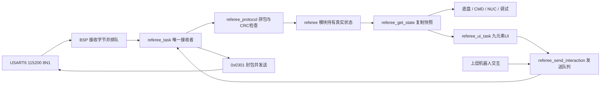

# 裁判系统 FreeRTOS 移植说明

这次沿用旧 RTT 工程 `src/task/rm_task.h` 的实际字节布局，以及 `src/task/referee/UI_Print/protocol/crc/crc.c` 的 CRC 参数。它是旧工程协议的迁移，**没有声称已经兼容某个新赛季的裁判协议**。旧文件的枚举注释与结构体偶有不一致，新模块只对下面核对过长度的消息生成状态。

旧接收实现的作者记录：ChenSihan（2024-01-19）、SuperChen（2025-03-03）。新协议文件保留了这项来源说明。

## 数据怎么走



- `Modules/referee/referee_protocol.c`：只把字节变成合法报文，也能给发送数据加包头与 CRC；没有 HAL、FreeRTOS 或电机知识。
- `Modules/referee/referee.c`：检查具体命令长度、解码并保存私有状态。读取者得到一个副本，不能改掉模块原件。
- `Task/referee/referee_task.c`：每 2 ms 取一批串口数据；发现 BSP 接收代次变化就丢弃旧半包和排队发送内容。发送请求走静态 FIFO。
- `Bsp/referee`：负责真实 USART6，不向上暴露 DMA 指针。`bsp_referee_send()` 必须复制调用者数据再异步发送。

BSP 使用 1024 字节循环 DMA，保留 HT、TC 与 IDLE 通知，将已收字节按最多 128 字节分块复制到深度 16 的静态 FIFO。一条通知拆出的各块保留相同接收时间戳。回调读取实际 DMA 剩余计数得到当前写入点，避免迟到的 HT/TC 通知把 IDLE 已处理过的字节再次入队。队列满或 UART 出错后立即停止接受旧流，任务用 `HAL_UART_Abort()` 停止收发、清队列与 TX busy，再重新启动。发送使用常驻缓冲区与 `HAL_UART_Transmit_IT()`；100 ms 未完成也会触发任务恢复。

在 115200、8N1 下，1024 字节环约容纳 89 ms 数据。HT/TC 中断必须保持启用，不能长期屏蔽 USART6/DMA 中断；如果 DMA 在 CPU 完全不响应期间绕完整圈，单靠 NDTR 无法判断已经覆盖多少数据。

旧串口核对结果为 **USART6、115200、8 数据位、1 停止位、无校验**。新板引脚由本工程 BSP/Core 配置决定，不能仅凭旧串口名称推断接线。

## 已核对并发布的字段

| 命令 | 数据长度 | 快照内容 | 新鲜度组 |
|---|---:|---|---|
| `0x0001` | 11 | 比赛类型、阶段、阶段剩余秒数、同步时间戳 | `game` |
| `0x0003` | 32 | 红蓝机器人血量数组，含旧协议保留槽位 | `robot_hp` |
| `0x0101` | 4 | 场地事件原始位图 | `event` |
| `0x0201` | 13 | 机器人 ID/等级/血量、枪口冷却、热量上限、底盘功率上限、三路供电状态 | `status` |
| `0x0202` | 16 | 缓冲能量 J、两个 17 mm 枪口热量和 42 mm 枪口热量 | `power_heat` |
| `0x0207` | 7 | 子弹类型、枪口、发射频率 Hz、初速度 m/s | `shooting` |
| `0x0208` | 6 | 17 mm/42 mm 余弹、金币数量 | `allowance` |

其他 CRC 正确的命令可以被框架正常消费，并计入 `unsupported_commands`，但不伪造已解码的状态。新字段应在核对实际协议后扩展 `handle_frame()`，同时补充独立报文测试。

**电流/功率的关键细节：**旧 `power_heat_data_t` 的前 8 字节已经叫 `reserved_1`、`reserved_2`、`reserved_3`，只是行尾还留着更早的电压/电流/功率注释。因此新快照只保留 `legacy_voltage_raw`、`legacy_current_raw`、`legacy_power_bits` 用于观察。不能把它们当作有效的实时电流或功率输入；`chassis_power_limit_w` 来自已经核对的 `0x0201`，`buffer_energy_j` 来自 `0x0202`。

## 正确读取状态

```c
#include "referee/referee.h"

RefereeState referee;
if (referee_get_state(&referee) && referee.status.fresh) {
    /* 这份功率上限确实来自最近的 0x0201。 */
    uint16_t limit_w = referee.chassis_power_limit_w;
    (void)limit_w;
}
```

`online` 只说明最近 1000 ms 收到过 CRC 正确的裁判帧，不能代替每组 `.fresh`。功率热量 500 ms 过期；机器人状态等周期数据 1500 ms 过期；射速 1000 ms 过期。射速是发射事件数据，未发射时变旧不代表串口故障。`received=false` 说明还没有该组数据，和“收到数值 0”是两件事。掉线时保留历史值便于排查，但必须检查新鲜度再参与控制。

只有短暂的快照复制进入 FreeRTOS 临界区。CRC、报文解析和串口发送都不关中断。读取快照时重新计算时间，因此即便接收任务停住，读取者也不会一直看到 `fresh=true`。

## 半包、粘包与错误恢复

把串口理解成“水流”：一次收到 32 字节，可能是半包，也可能是两包半，不能按接收回调次数分包。

1. 找 `0xA5` 起始字节；5 字节头到齐后先检查 CRC8。
2. 核对数据长度，整包最多 128 字节，即数据最多 119 字节。
3. 收齐 `头5 + 命令2 + 数据N + CRC16尾2` 后再检查整包 CRC16。
4. 坏包只丢一个起始字节重新查找，因此坏包内藏着的下一条合法消息还有机会被找回。
5. 相邻接收块间隔超过 100 ms，丢弃没拼完的半包；BSP 检测到重启、溢出或丢字节时，也必须改变 generation，任务立即重新拼包。
6. 合法 CRC 不等于字段可信。每种已知命令仍检查精确长度，射速拒绝 NaN、无穷大与负数。

## 发送接口与 UI 边界

`referee_send_interaction(data_command, receiver_id, data, length)` 给 `0x0301` 内层机器人交互数据排队。发送任务自动加当前机器人的 sender ID、包序号、CRC8 和 CRC16，上层无需知道串口如何工作。单次业务数据最多 113 字节；FIFO 深度 4；任务采用 100 ms 最小发送间隔，作为保守调试默认值，**这不是对某赛季所有命令配额的声明**。

返回 `true` 表示已经进入队列，实际交给串口看 `debug_referee.tx_accepted`；BSP 忙而未接受的尝试计入 `tx_rejected`，任务保留该请求供下次重试，避免 UI 首轮 ADD 排队后永久丢失。离线、状态过期或身份/代次改变则丢弃旧请求。快照 `generation` 在 UART 重启或机器人 ID 变化时递增，UI 据此重新绘制；每条发送请求也保存 sender ID 和代次，不能把旧客户端地址套到新机器人身份上。UART 交付成功不等于对端确认收到。

本次另用 `Modules/referee_ui` / `Task/referee_ui` 移植旧九元素 UI：Frc、Rot、Aim、Heat、两条准星、瞄准圈、两条车宽线。每100ms轮转发送一个元素，上电/恢复/身份换代/R键时 ADD，此后同名 MODIFY。编码使用明确的位移与小端字节，保留旧布局配色；没有携带旧通用优先级调度框架。详见 [UI移植说明](referee_ui.md)。UI调用本发送入口，不直接调用 HAL，也不复用任务的临时发送数组。

## 一次上板怎么查

1. 接好裁判串口后，看 `debug_referee.rx_bytes` 和 `valid_frames` 是否持续增加。前者不动先查接线、串口配置；前者动后者不动看 CRC 错误和波特率。
2. `online=1` 但 `status_fresh=0`：没有正常解码最近的 `0x0201`；看 `last_command`、`invalid_payloads`，对照真实赛季报文长度。
3. `status_fresh=1` 后核对 `robot_id` 和 `chassis_power_limit_w`；`power_heat_fresh=1` 后再看 `buffer_energy_j`、`heat_17mm_1`。
4. 拔掉串口，确认 500 ms 后功率热量过期，1000 ms 后链路离线；重新连接应自动恢复。真实上板情况仍需本步骤验证。

主机测试 `Tests/test_referee.c` 已覆盖独立 CRC 固定向量、任意拆包边界、粘包、噪声、CRC8/CRC16 错误、嵌套合法包恢复、128 字节边界、业务长度错误、NaN 拒绝、状态副本隔离、各组超时、串口代次重置和 32 位毫秒回绕。测试不替代实车通信验证。

`Tests/test_referee_bsp.c` 另行覆盖 DMA 半满/全满/回绕、迟到 HT/TC 去重、FIFO 溢出隔离与重启、Abort/启动失败、TX 常驻缓冲生命周期、错误恢复和 TX 超时恢复；原有 DBUS 测试也验证了新增回调分发不改变 USART3 行为。
