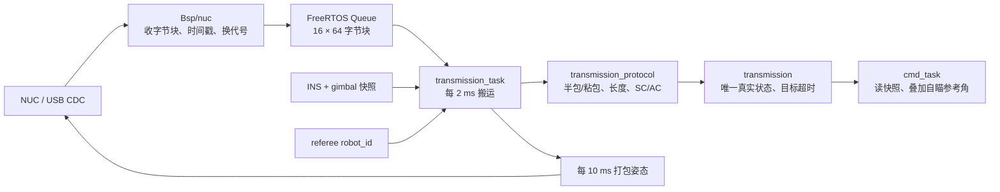

# NUC / transmission：FreeRTOS 移植说明

## 一句话看懂

NUC 用 **USB 虚拟串口**连接本板；USB 中断只把收到的一小块字节放进队列，`transmission_task` 拼成完整 BCP 帧，模块保存状态，`cmd_task` 只读取副本。



新增代码按目录分工：

| 目录 | 负责什么 |
|---|---|
| `Bsp/nuc` | USB FS / CDC 枚举、收发字节、掉线和重连；不理解目标角度 |
| `Modules/transmission/transmission_protocol.*` | 纯字节协议；不用 FreeRTOS 和 HAL |
| `Modules/transmission/transmission.*` | 保存角度/心跳，做超时，发布完整快照 |
| `Modules/transmission/transmission_tx.*` | 纯发送节拍：心跳、姿态、busy重试；不用RTOS/HAL |
| `Task/transmission` | 搬运输入，读 INS/云台/裁判系统，提供角度/角速度/参考状态 |
| `Middlewares/ST/STM32_USB_Device_Library` | 本机 STM32Cube F4 V1.28.3 的 ST USB Core + CDC 原始库，保留 LICENSE |

## 接线、时钟与枚举

- 使用 `USB_OTG_FS`：PA11=DM，PA12=DP。NUC 仍插旧 USB 口，**不是把 NUC 改接 USART3**。
- 保留旧配置 VID/PID：`0x0FFE / 0x0001`。产品名改为 `OMNI NUC Virtual Serial`，序列号来自芯片 UID；若 NUC 按旧字符串、`/dev/serial/by-id` 或固定 COM 号绑定，需更新绑定。
- USART3 继续服务遥控器；USART6 服务裁判系统，由另外的 BSP 管理。
- 旧板 PA9 被 USART1_TX 使用，USB 禁用 VBUS sensing，不能照抄 ST 示例把 PA9 重配为 USB VBUS。PA10 也不被本代码改动。
- USB 要 48 MHz 时钟；主工程配置 336 MHz PLL VCO / PLLQ=7。仅加 USB 源文件而保持原 PLLQ=4，无法正常枚举。
- `OTG_FS_IRQn` 优先级 5，与使用 FreeRTOS FromISR API 的要求一致。`OTG_FS_IRQHandler` 由 `Core/Src/stm32f4xx_it.c` 提供，使用 CubeMX 的 `hpcd_USB_OTG_FS`，不可再定义一份。
- 初始化在任务中执行，不能套长临界区：HAL 初始化等待毫秒时间，关中断等待可能永远走不出来。
- CDC 类对象静态分配；发送内容先复制到长期有效的 buffer。USB 还在发上一包时返回 busy，不等、不覆盖，不把任务局部数组的失效地址交给 USB。

## BCP协议：保留旧字段，扩展角速度与主动心跳

**BCP 不是裁判系统协议；没有 CRC，也没有直接传 IEEE float。**

| 字节位置 | 内容 |
|---|---|
| 0 | `0xFF` 帧头 |
| 1 | 目的地址；本板发送给 NUC 时是 `0x01` |
| 2 | `0x20` 云台；`0xF0` 心跳 |
| 3 | DATA 字节数 LEN |
| 4 到 4+LEN−1 | DATA |
| 4+LEN | SC 和校验 |
| 5+LEN | AC 附加和校验 |

`0x20` 的 LEN=25，所以总长 **31 字节**。心跳支持旧程序固定 31 字节的 LEN=25，也支持只含一个心跳字节的 LEN=1（总长 7）。未知 ID 不作为链路或目标的新鲜证据。

| DATA 内偏移 | NUC → MCU | MCU → NUC |
|---|---|---|
| 0 | 原样保存 `raw_target_flag` | 固定 0 |
| 1..4 | yaw，int32 小端 /1000，接收时取负 | yaw，度×1000 转 int32 小端 |
| 5..8 | pitch，int32 小端 /1000 | pitch，度×1000 转 int32 小端 |
| 9..12 | 开火建议，0 或 1000 | 固定 0，沿用旧程序 |
| 13..16 | 当前不使用 | 队伍颜色×1000：红=1000、蓝=0、未知=−1000 |
| 17..20 | 保留 | 新增 yaw 轴角速度，度/秒×1000，int32小端 |
| 21..24 | 保留 | 新增 pitch 轴角速度，度/秒×1000，int32小端 |

SC/AC 要逐字节模 256，规则与旧 `Check_Rpy()` 一致：

```text
SC = HEAD + D_ADDR + ID + LEN
AC = SC                 ← 4 个头字节一起求和后，仅累加这一次
for 每一个 DATA 字节:
    SC += DATA[i]
    AC += SC
```

兼容向量：yaw=−1.5°、pitch=2.25°、红方、两个角速度为0，发送整帧为：

```text
FF 01 20 19 00 24 FA FF FF CA 08 00 00 00 00 00
00 E8 03 00 00 00 00 00 00 00 00 00 00 12 D6
```

最后的 `12 D6` 是 SC/AC。不要换成 CRC16，也不要对头的每个字节分别做二重累加。

### 兼容边界与不能凭空确定的事情

1. 旧 MCU 对 `DATA[0] != 0` 与 `== 0` 的处理完全相同，所以现有源码**不能证明该字节表示目标有效**。新版保留它作观测，默认有效且新鲜的角度帧就可用；不能声称“收到 flag=0 一定无目标”。若视觉无目标仍持续发送旧角度，超时无法发现，必须与 NUC 端确认 flag 约定或无目标时停止发目标包。
2. 旧接收未检查 D_ADDR。本次默认兼容所有地址，只保存 `destination` 供抓包；上位机确认后才可收紧地址过滤。因收发共用 0x20，**把发出的姿态原样回环回来可能被认作目标**，调试串口请关闭自动回显。
3. 接收增加结构和内容检查：必须通过 SC/AC、长度正确；yaw 绝对值≤3600°、pitch≤180°、开火建议只能为 0/1000。范围是防明显坏数据，实际机械限位由云台模块执行。
4. 旧接收代码没有验证 SC/AC；如果旧 NUC 一直填零校验，新版会拒绝，这是故意修复坏包可驱动车辆的问题。用实际包与上述算法核对 NUC 打包器。

## 云台坐标约定

本次保留旧 NUC 约定，模块只转换字节和 yaw 符号，不悄悄改变坐标系：

- **接收**：yaw/pitch 是传给 cmd 的相对角度。进入 AUTO 时，cmd 锁存当时手动云台目标角；后续绝对目标为“锁存角 + NUC 接收角”。接收模块不把当前 INS 角不断叠加，避免重复累加越转越远。
- **发送 yaw**：归中时的 INS yaw − 当前 INS yaw，沿用旧取负方向。
- **发送角速度**：Yaw为 `-INS.yaw_rad_s×180/π`，Pitch为 `INS.pitch_rad_s×180/π`，与旧姿态轴方向一致。这是陀螺仪轴角速度，不宣称是完整欧拉角导数。手动时pitch参考不断更新，回报角度接近0但轴角速度可非0，这是参考约定，不是传错数。
- **发送 pitch**：手动 GYRO 时持续刷新 pitch 参考，进入 AUTO 后冻结最近手动 pitch；回报当前 pitch − 冻结参考。因此手动模式回报 pitch 接近 0。这对应旧云台在 GYRO 中更新 `pit_offset_angle`、AUTO 中不更新的行为。
- 归中未完成、INS 无效或参考代次不匹配时不发送伪姿态。重新归中或 INS 重启后作废旧目标，等新的目标字节。
- 裁判系统 robot_id 新鲜时识别红 1..11、蓝 101..111；没收到/过期/未知 ID 时发 UNKNOWN=−1。不会再把启动时 ID=0 当作红方。

## 掉线和旧目标为什么不会复活

- **目标期限 100 ms**：只由有效 0x20 更新。心跳不能刷新它。
- **链路期限 500 ms**：合法目标或心跳更新，用来区分“通信还活着，但没有新目标”。
- `transmission_get_state()` 复制后再次验时间：即使 transmission 任务暂时没运行，cmd 也不会无限期读到有效目标。
- 目标过期后清除有效标记；以后只有心跳恢复不会把旧目标重新设为有效。`fire_advice` 随目标失效立即清零；它只是建议，不能绕过遥控许可和扳机单独开火。
- USB reset/suspend/disconnect、重新枚举、队列溢出都会换代。接收队列保存自己的代次，旧代次块被丢弃，半帧被清空，防止“断线前半包 + 重连后半包”拼出假帧。
- 队列积压超过 100 ms 的字节不再解析；半包间隔超过 100 ms 也重新找帧头。

## 快速看变量和上板验证

| 变量 | 预期 / 解释 |
|---|---|
| `debug_nuc_usb.initialized` | 1：USB 外设初始化成功 |
| `debug_nuc_usb.configured` | 1：NUC 已完成 CDC 枚举，不代表已有目标 |
| `debug_nuc_usb.rx_packets` | NUC 发包时增加；不涨先查USB/端口 |
| `debug_nuc_usb.dropped_packets` | 应为0；上涨说明处理不及时，模块会换代丢旧流 |
| `debug_transmission.checksum_errors` | 应为0；上涨核对 NUC 的 SC/AC 算法 |
| `debug_transmission.invalid_frames` | 地址不作为拒绝原因；上涨查 ID、LEN、角度和 fire 数值 |
| `debug_transmission.target_frames` | NUC 发 0x20 时增加 |
| `debug_transmission.online` | 500 ms 内有合法角度或心跳 |
| `debug_transmission.aim_valid` | 100 ms 内有合法目标角度包 |
| `debug_transmission.raw_target_flag` | 观察 NUC 有目标/无目标时是否变化，先确认含义 |
| `debug_transmission.tx_frames` | 归中和 INS 就绪后约每秒增加 100 |

验证顺序：先让 NUC 枚举到设备并收到姿态；再发送上述已知角度/校验格式，确认 `target_frames` 增长与 yaw 符号；保持心跳、停止目标包，确认 100 ms 后 `aim_valid=0` 而 `online=1`；拔插 USB，确认旧角度不再有效，必须重新发目标包。

`Tests/test_transmission.c` 覆盖固定协议向量、符号/小端、逐字节半包、粘包、噪声/错长度/错校验恢复、非法范围、超时、心跳不续目标、换代、参考失效、旧队列数据与时间绕回。

`Tests/test_nuc_usb.c` 用最小 USB/队列替身验证初始化失败重试、单一静态类对象、发送buffer复制与busy不覆盖、接收复制、队列溢出换代、断线重连旧包作废。它验证 BSP 生命周期逻辑，**不能代替真 USB 主机的枚举、电气与收发验证**。

### USB 时钟再次由 CubeMX 生成后的接法

`main` 调用 `MX_USB_OTG_FS_PCD_Init`；`Core/Src/usb_otg.c` 唯一拥有 PCD 句柄和 MSP；`stm32f4xx_it.c` 唯一拥有 OTG_FS 中断。Bsp 的 `USBD_LL_Init` 只关联 USB Device/PCD 对象并配置 FIFO，失败重试时才按需重新初始化 PCD。硬件全局中断由 `HAL_PCD_Start` 在协议栈准备完成后开启。

CubeMX 保持 USB_OTG_FS Device_Only、VBUS sensing disabled、OTG_FS NVIC抢占优先级5，FreeRTOS TOTAL_HEAP_SIZE=32768。生成的 STM32_Drivers 编译三份 HAL USB 源码，根 CMake 只添加 Device/CDC 中间件，避免重复符号。

## 2026-09-27：NUC 端需要同步的两项扩展

旧RTT代码 `src/task/transmission/transmission_task.c` 的姿态包 `DATA[17..24]` 全为0，没有角速度；旧MCU只接收心跳，没有主动发心跳。这次保留25字节姿态DATA和旧角度/队色位置，新增末尾两个int32角速度。NUC不能把它们按float解释。

MCU→NUC 心跳为 `FF 01 F0 01 seq SC AC`，总长7字节，约每100ms一次，seq成功提交后递增并自然回绕。只要USB就绪就可发，不要求云台已归中；归中参考可用时另以约10ms间隔发送31字节姿态。两者共用USB通道，心跳到期时先发心跳，姿态留到下一次服务；因此100Hz是目标频率，忙和心跳会带来延迟。没有排队重放旧姿态，下一次尝试取最新输入。

**NUC读流必须按帧头、ID、LEN和SC/AC组帧，不能每次固定读31字节就当一帧。** 旧RTT接收端曾固定读31字节；如果NUC也这样实现，需要一起修改。暂时无法改NUC解析时可将 `Modules/transmission/transmission_tx.h` 的 `TRANSMISSION_TX_HEARTBEAT_ENABLE` 设为0并重新编译，恢复只发31字节姿态。默认1，以满足双向心跳联调；接收NUC心跳不受此发送开关影响。

NUC→MCU继续兼容LEN=1或25的心跳；`heartbeat_online/heartbeat_age_ms` 独立记录心跳500ms新鲜度。有效目标仍可独立证明链路在线，自瞄要求新鲜目标而不额外强制每台旧NUC都发送心跳。心跳绝不会续命超过100ms的目标。USB/队列换代会作废旧心跳及旧目标。

发送侧由 `transmission` 拥有真实计数与最后接受样本，任务调用服务接口即可，不直接排USB发送队列。`tx_ready` 表示USB可用，`tx_reference_valid` 表示姿态参考可用；`tx_attitude_age_ms` 在断线/参考无效/尚未发过姿态时为UINT32_MAX。最后一次的角度数值仍保留供诊断，不能单看数值就认为仍在发。

验收顺序：LinkScope第14组检查USB与NUC→MCU心跳；第15组检查MCU→NUC角度、角速度和心跳；第13组检查SW2下位的AUTO请求及阻断位。NUC分别停止目标和停止心跳，确认两种超时互不替代；重新连接并确认旧目标不会恢复。协议主机测试验证字节/超时/忙重试，不能代替真USB和NUC程序联调。

新增固定测试向量（yaw=-1.5°、pitch=2.25°、yaw角速度=-123.5°/s、pitch角速度=45.25°/s、红方）：

```text
FF 01 20 19 00 24 FA FF FF CA 08 00 00 00 00 00
00 E8 03 00 00 94 1D FE FF C2 B0 00 00 32 48
```

MCU发给NUC的seq=42心跳为 `FF 01 F0 01 2A 1B 0C`。
