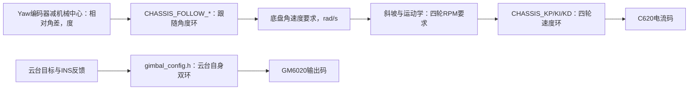

# 调参只看这些入口

本页描述当前FreeRTOS实现。宏是否生效，取决于初始化/计算代码是否读取它；不能只看名字。
修改参数后保存、重新编译并烧录，LinkScope使用同一次构建的ELF。debug_*通常是观察副本，写它不等于改控制器。

| 要调的动作 | 文件 | 真正生效的配置 |
|---|---|---|
| 车头追云台的相对角差 | Task/chassis/chassis_config.h | CHASSIS_FOLLOW_KP/KI/KD、I_LIMIT_RAD_S、MAX_RAD_S、DEADBAND_DEG、DIRECTION |
| 底盘转速要求变化快慢 | 同上 | CHASSIS_YAW_ACCEL_RAD_S2；总角速度上限CHASSIS_MAX_YAW_RAD_S |
| SW1下位小陀螺速度 | 同上 | CHASSIS_SPIN_RAD_S |
| 四轮转子速度环 | 同上 | CHASSIS_KP/KI/KD、CHASSIS_I_LIMIT、CHASSIS_CURRENT_LIMIT_RAW；单轮可改CHASSIS_SPEED_PID_CONFIGS对应行 |
| 云台Yaw/Pitch双环 | Task/gimbal/gimbal_config.h | 每轴的KP/KI/KD/INTEGRAL/MAX，A=角度环、V=速度环，IMU=手动、AUTO=自瞄 |
| 云台归中/活动范围 | 同上 | CENTER_ECD_YAW/PITCH、PIT_ANGLE_MIN/MAX、BACK_CENTER_TIME、GIMBAL_HOME_TIMEOUT_S |
| 摇杆/鼠标推动云台的速度 | Task/cmd/cmd_config.h | CMD_*_STICK_RATE_DEG_S、CMD_*_MOUSE_RATE_PER_COUNT；云台另有GIMBAL_MAX_RATE_DEG_S最终限速 |
| 遥控死区/拨轮触发门槛 | 同上 | CMD_STICK_DEADBAND、CMD_FIRE_WHEEL_THRESHOLD |
| 摩擦速度/停车PID | Task/shoot/shoot_config.h | FRICTION_SPEED_*、FRICTION_BRAKE_* |
| 拨弹双环 | 同上 | TRIGGER_ANGLE_*（转子度到RPM）、TRIGGER_SPEED_*（RPM到电流码） |
| 电机接线与编号 | Task/robot.c | motor_config；左右摩擦ESC编号引用shoot_config.h的FRICTION_*_ESC_ID |
| CPU/外设时钟 | CubeMX与Core/Src/main.c | SystemClock_Config；改旧CPU_FREQUENCY宏不会配时钟，该无效宏已删除 |

## 三种PID不要混淆

跟随使编码器相对角差趋近0，不是让INS世界Yaw回到0。第9组只画三条曲线：角差、跟随要求角速度、四轮反馈反算角速度；后两条单位一致可比较。先确认active=1、spin=0、measured_velocity_valid=1、fault_flags=0。

跟随Kp没有到限速时，增加Kp会增加同一角差下要求的速度；要求速度已经顶住MAX时，只加Kp不会更快。Ki非零还需要积分限幅非零。方向错误时先查中心和符号，不靠加Kp纠正。

## 此次清理修正了什么

- 删除gimbal_config.h里的旧CHASSIS_*_V_FOLLOW、ROTATE_*、GIMBAL_*_MOVE_RATIO、未使用的反馈ID和SIDEWAYS_ANGLE；不存在第二套同名功能的失效入口。
- 删除无人包含的Task/rm_config.h，其中CAN字符串和CPU_FREQUENCY都不控制当前硬件。
- 云台40个PID参数全部接入各自模式：原先部分Ki/积分限幅写死0，AUTO的限幅借用了IMU。现有对应值本来相等，所以接回配置不改变当前增益。
- 摩擦和拨弹PID从control.c的数字移到shoot_config.h；输出码限幅与电机注册共用。GM6020注册仍有30000、C620协议有16384、C610协议有10000的最终上限；提高PID最大输出不会越过它们。
- 遥控倍率移到cmd_config.h，小陀螺速度移到底盘配置。保留现有实际数值，不用旧失效倍率替换当前控制值。
- GIMBAL_SIDEWAYS确实会切换机械中心，因此保留；它只切换中心，不提供额外坐标旋转。未删除仍正常使用的算法选项与设备API。

用户先前写在旧失效跟随宏里的0.40/0.002随原文件保存在清理备份中，没有复制到新跟随环。清理对照时有效参数为Kp=0.06、死区1°、限速1.8rad/s；用户随后继续调成Kp=0.4、Kd=0.001，工作区继续保留用户最新值，不回写默认参数。实际值始终以当前配置文件为准。

验证包括真实控制对象在手动/自瞄切换后的配置检查；测试另用每个字段都不同的哨兵值，避免默认值相等掩盖接线错误。回归测试与编译不能代替实车调参。

本次验证：20组主机测试通过、ARM Debug构建通过；回归用例在旧初始化代码上因Ki未接入而失败，在修复后通过。清理前后ARM可烧录二进制逐字节一致，SHA-256均为7edfa50027269b561e4a4d1589b589fd25cca8120448f27fd71101ca57f727f2（对照包含用户当时Kp=0.06、死区1°、限速1.8rad/s）。FLASH 128144 B，RAM 53880 B。未烧录、未代替实车确认；备份在 `.migration-backup/config-cleanup-20260927-203200/`。
